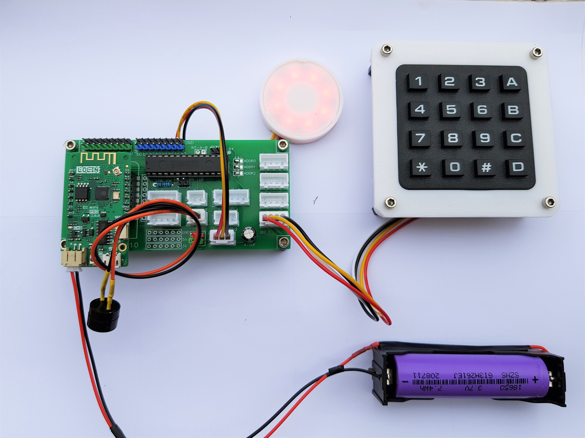
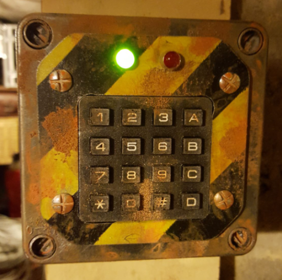
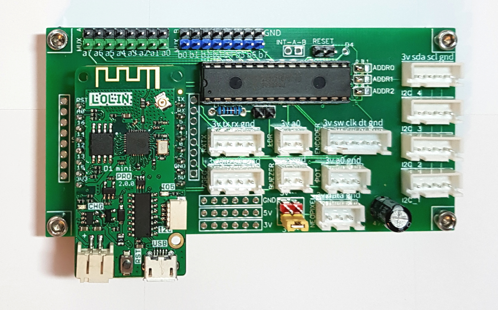
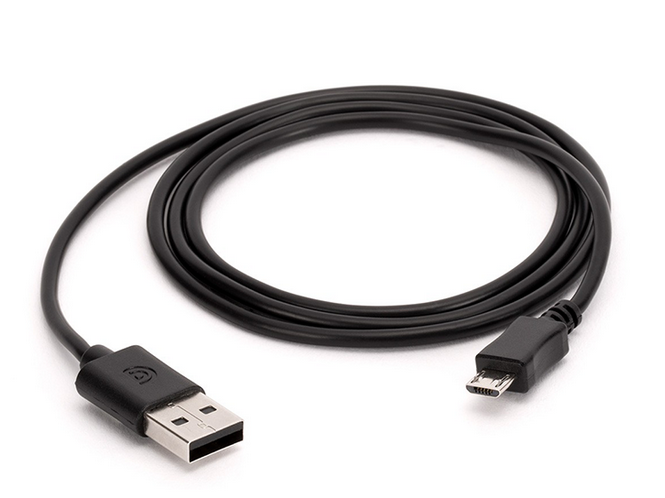
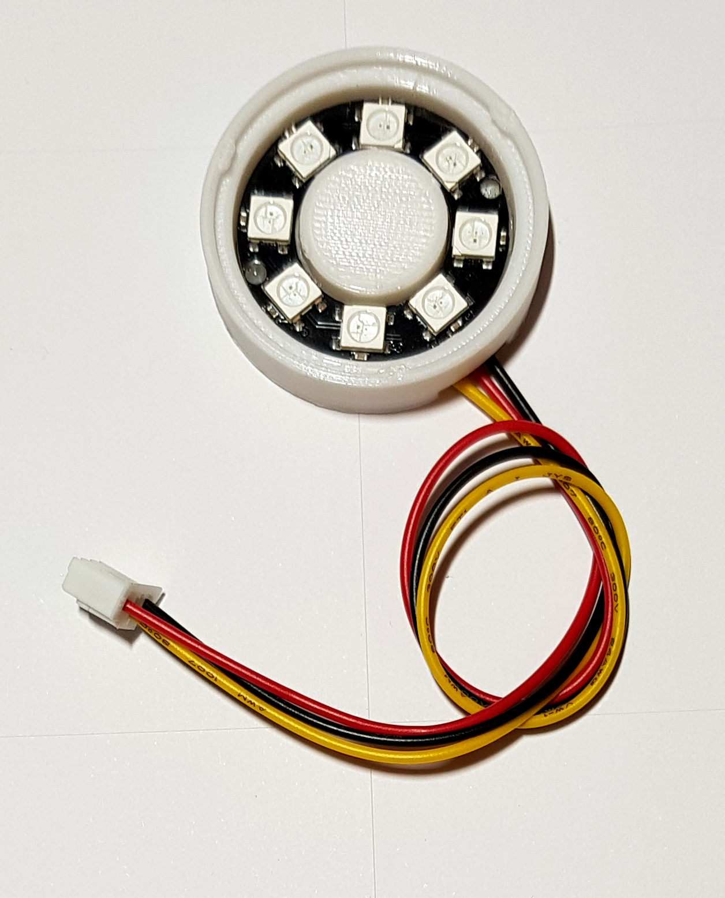
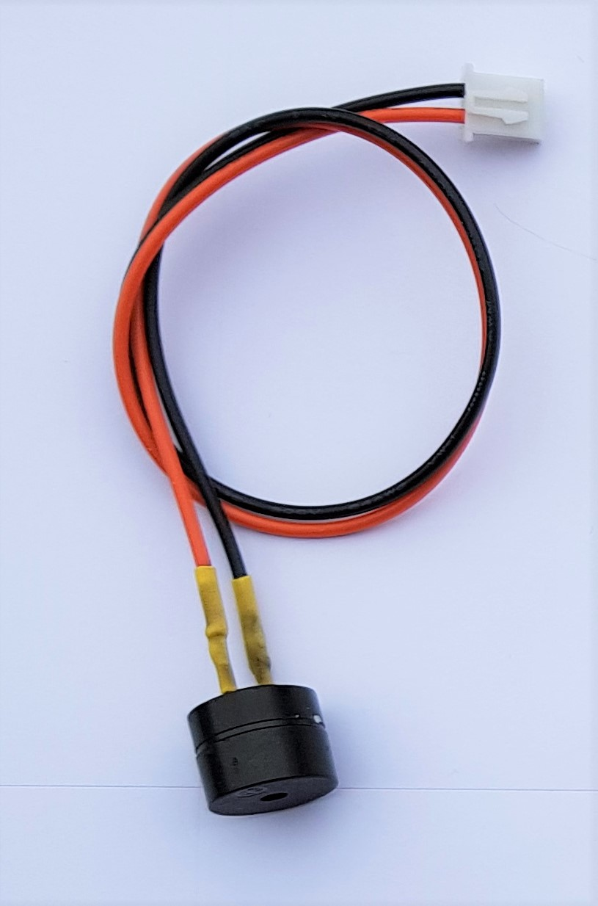
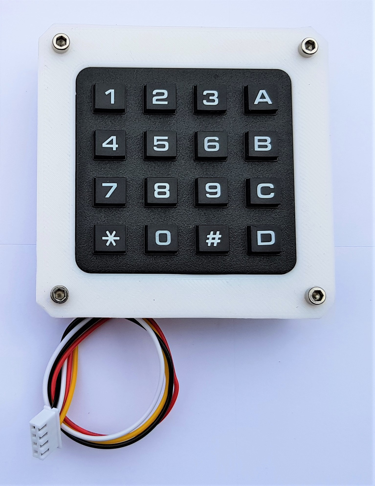
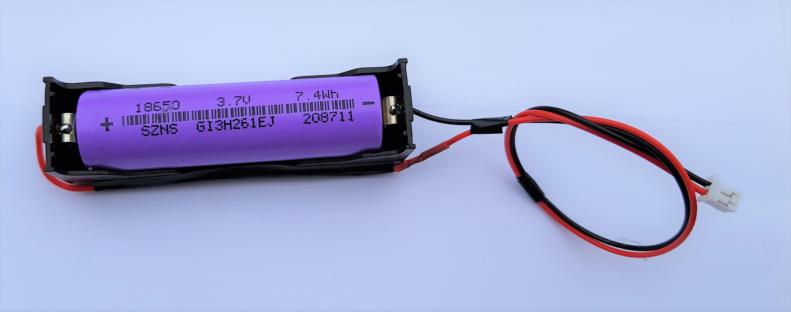
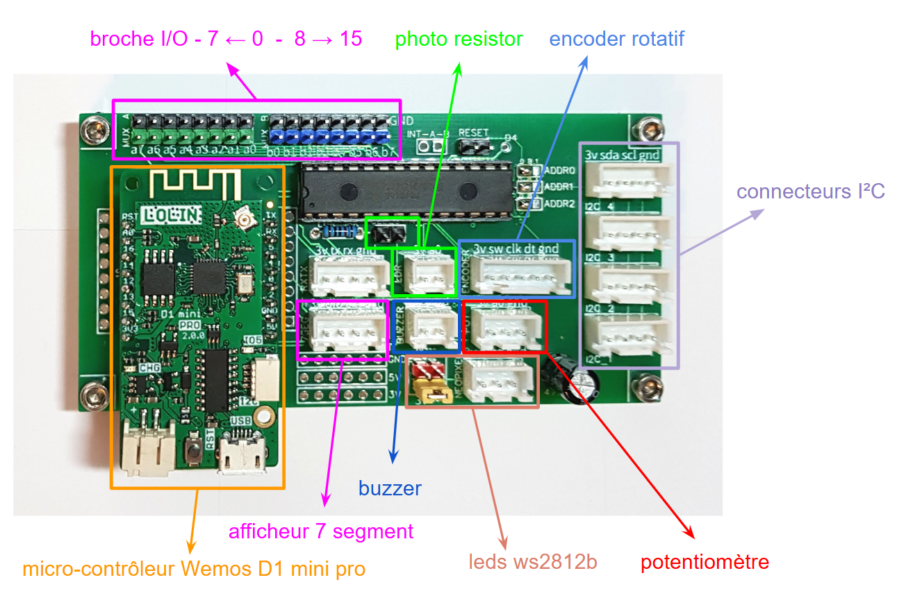
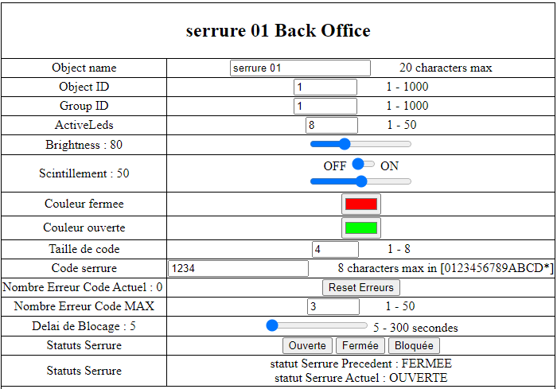

# serrure_clavier_01
Cet objet simule une serrure d'aspect contemporain qui s'ouvre et se ferme à l'aide d'un clavier 4x4. Le code est enregistré en mémoire. De nombreux paramètres sont configurables via un back office accessible en wifi.

La serrure possède trois états
* FERMEE, la serrure est fermée
* OUVERTE, la serrure est ouverte
* BLOQUEE, la serrure est temporairement bloquée après plusieurs faux codes. Dans ce cas, les leds clignotent dans deux couleurs.

Le code par défaut est 1 2 3 4. Pour entrer un code, appuyer sur les touches 0 à 9, A, B, C, D ou *. Il faut valider le code en appuyant sur la touche #. Exemple, pour entrer le code A 1 B 2, appuyer successivement sur la touche A, sur la touche 1, sur la touche B, sur la touche 2 en enfin sur la touche #.

Une fois la serrure mise sous tension par batterie ou câble USB, elle se place dans l’état FERMEE. Si la serrure est éteinte, elle enregistre son état actuel et retourne dans cet état à l’allumage.

## Exemple
Un exemple du kit technoLARP monté pour une serrure_clavier_01

Voici un exemple de casing plus avancé

## Composants
Vous aurez besoin pour monter la serrure_clavier_01

|  | |
| :---------------- | :------: |
| Un kit technoLarp |  |
| Un câble micro-USB |  |
| Un ruban ou d’un anneau de led ws2812b ou neopixel |  |
| Un buzzer piezo |  |
| Un clavier matriciel 4x4 et 1 module PCF8574 |  |
| Une batterie 18650 et son support |  |

## Branchements
 - Branchez le Un clavier matriciel sur le connecteur I2C_1
 - Branchez le Ruban ou anneau led ws2812b sur le port "leds ws2812b"
 - Branchez le buzzer sur son port "buzzer"
 - Branchez la batterie sur son port dédié (sur le micro-contrôleur Wemos D1 mini pro)

## Installation
Pour installer le firmware de l'objet, il faut suivre ce [tutorial](https://github.com/technolarp/technolarp.github.io/wiki/Installation-du-firmware)  

## BackOffice
Pour se connecter au back office de l'objet, il faut suivre ce [tutorial](https://github.com/technolarp/technolarp.github.io/wiki/Connexion-au-back-office-de-l'objet-via-le-wifi)  

## Paramètres de gameplay
Ces paramètres permettent de contrôler le gameplay de l’objet.

| Nom                           | Descriptif                                                                                                                                                                       |
|-------------------------------|----------------------------------------------------------------------------------------------------------------------------------------------------------------------------------|
| **Object name**               | Le nom de l’objet, composé de 1 à 20 lettres et chiffres                                                                                                                         |
| **Object ID**                 | Un numéro d’identification de l’objet                                                                                                                                            |
| **Group ID**                  | Un numéro d’identification du groupe de l’objet                                                                                                                                  |
| **ActiveLeds**                | Le nombre de segments du panneau. Un segment est un groupe de 1 à 5 leds. Nombre entre 1 et 20.                                                                                  |
| **ledParSegment**             | Le nombre de leds groupées pour chaque segment du panneau. Entre 1 et 5                                                                                                          |
| **ActiveLeds**                | Le nombre total de leds utilisées par la bombe. entre 1 et 25                                                                                                                    |
| **Brightness**                | La luminosité des leds, entre 0 (éteinte) et 255 (pleine intensité)                                                                                                              |
| **Scintillement**             | Le scintillement permet d’activer le scintillement des leds pour un effet visuel plus ou moins rapide. le slider permet de régler la vitesse du scintillement                    |
| **couleurs fermée**           | Choix de la couleur quand la serrure est fermée                                                                                                                                  |
| **couleurs ouverte**          | Choix de la couleur quand la serrure est ouverte                                                                                                                                 |
| **couleurs transition**       | Choix de la couleur qui indique si un glyphe a été activé                                                                                                                        |
| **Taille code**               | La taille du code de la serrure. Entre 1 et 8                                                                                                                                    |
| **Code serrure**              | Le code de la serrure. A choisir parmi les caractères 0 1 2 3 4 5 6 7 8 9 A B C D et *                                                                                           |
| **Nombre Erreur Code Actuel** | Le nombre de faux codes déjà entrés. Ce nombre repasse à 0 automatiquement quand le bon code est entré. Le bouton reset erreurs permet aussi de remettre ce compteur à 0.        |
| **Nombre Erreur Code MAX**    | Le nombre maximum d’erreurs. Une fois atteint, la serrure se bloque pendant plusieurs secondes (voir Délai de Blocage).                                                          |
| **Délai de Blocage**          | Le temps pendant lequel la serrure est bloquée après plusieurs faux codes.                                                                                                       |
| **Statuts Serrure**           | Le statut actuel de la serrure. Les boutons permettent de forcer un changement de statut.                                                                                        |

## Paramètres Réseau

Pour avoir le descriptif des paramètres réseau suivez ce [lien](https://github.com/technolarp/technolarp.github.io/wiki/Param%C3%A8tres-R%C3%A9seau)  
