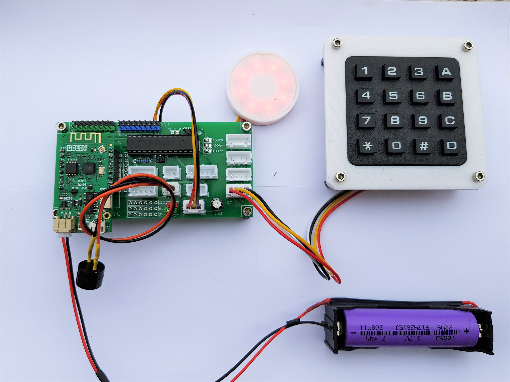
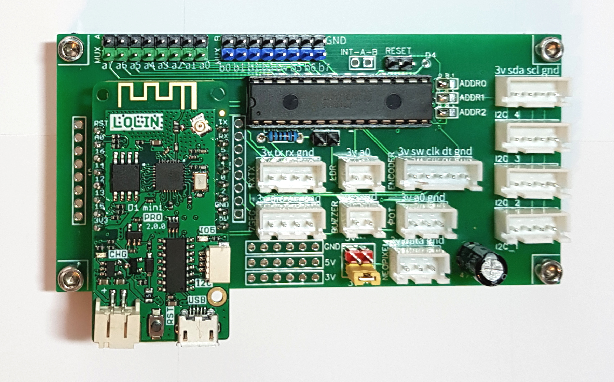
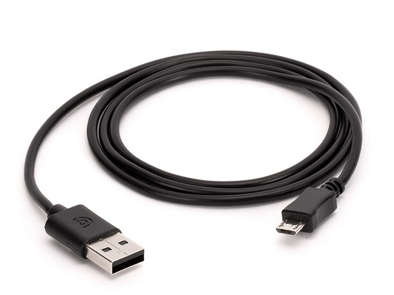
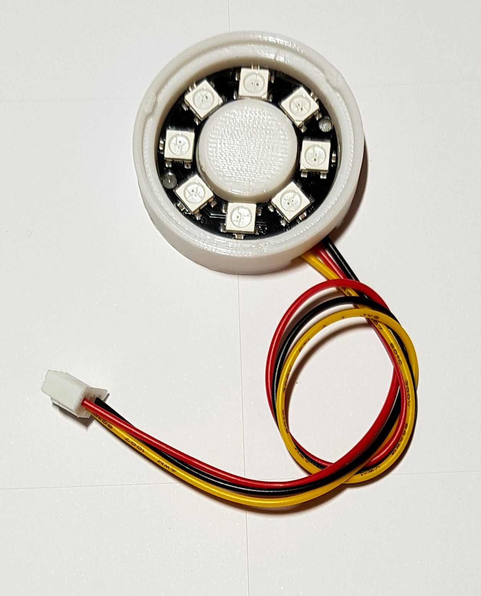
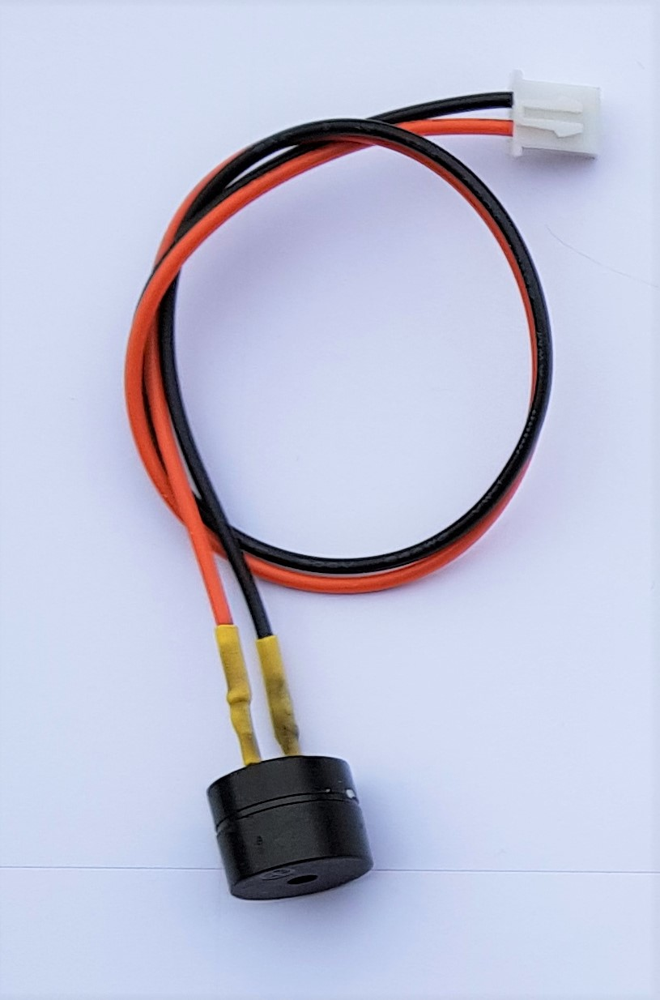
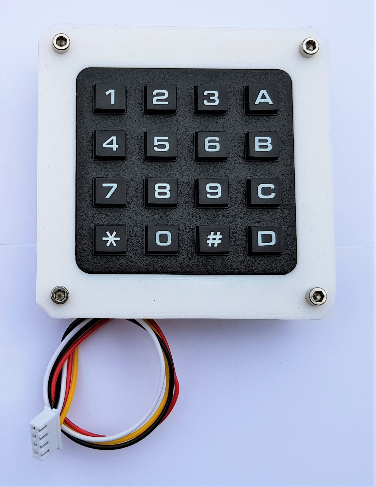
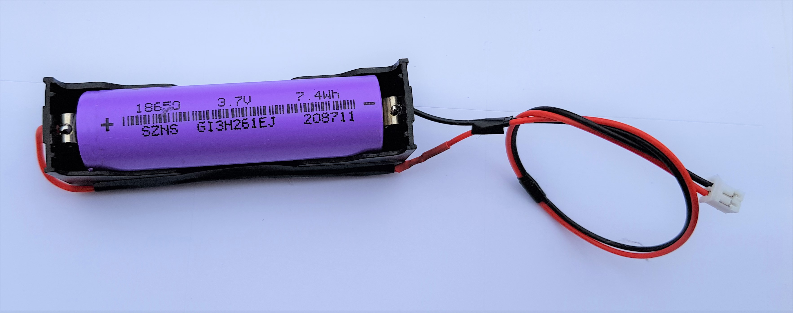

# serrure_clavier_01
Cet objet simule une serrure d'aspect contemporain qui s'ouvre et se ferme à l'aide d'un clavier 4x4. Le code est enregistré en mémoire. De nombreux paramètres sont configurables via un back office accessible en wifi.

La serrure possède trois états
* FERMEE, la serrure est fermée
* OUVERTE, la serrure est ouverte
* BLOQUEE, la serrure est temporairement bloquée après plusieurs faux codes. Dans ce cas, les leds clignotent dans deux couleurs.

Le code par défaut est 1 2 3 4. Pour entrer un code, appuyer sur les touches 0 à 9, A, B, C, D ou *. Il faut valider le code en appuyant sur la touche #. Exemple, pour entrer le code A 1 B 2, appuyer successivement sur la touche A, sur la touche 1, sur la touche B, sur la touche 2 en enfin sur la touche #.

Une fois la serrure mise sous tension par batterie ou câble USB, elle se place dans l’état FERMEE. Si la serrure est éteinte, elle enregistre son état actuel et retourne dans cet état à l’allumage.

## Exemple
Un exemple du kit technoLARP monté pour une serrure_clavier_01

## Composants
Vous aurez besoin pour monter le VU-mètre

|  | |
| :---------------- | :------: |
| Un kit technoLarp |  |
| Un câble micro-USB |  |
| Un ruban ou d’un anneau de led ws2812b ou neopixel |  |
| Un buzzer piezo |  |
| Un clavier matriciel 4x4 et 1 module PCF8574 |  |
| Une batterie 18650 et son support |  |
